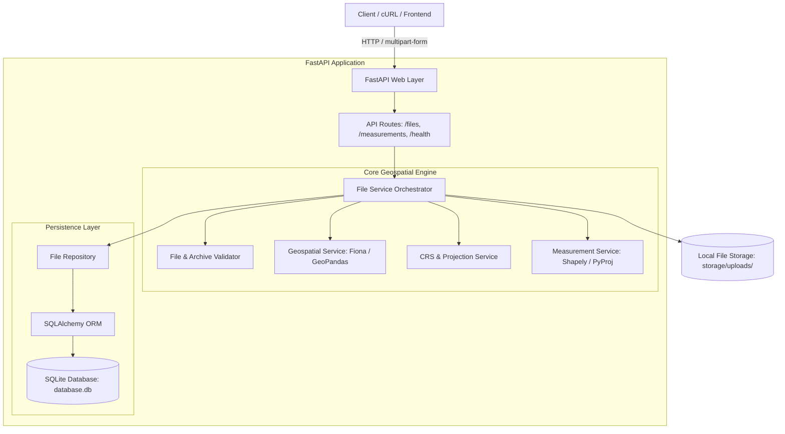
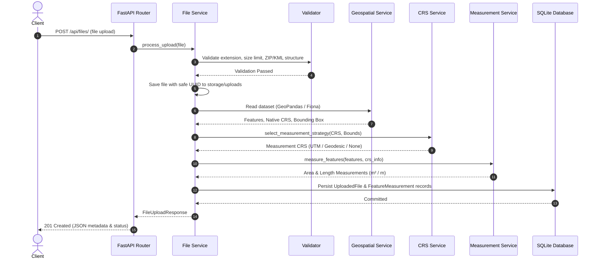
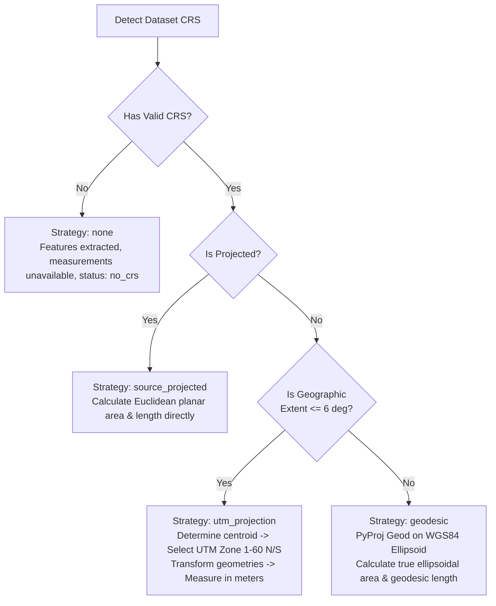

# GeoMeasure API — Geospatial File Measurement Service

[](https://www.python.org/)
[](https://fastapi.tiangolo.com/)
[](https://geopandas.org/)
[](LICENSE)

A production-grade, CRS-aware REST API built with FastAPI that processes geospatial files (ESRI Shapefiles packaged as `.zip` and Google Earth `.kml` files), extracts feature geometries and attributes, calculates polygon areas and line lengths using geodetically rigorous Coordinate Reference System (CRS) transformations, and persists results with SQLite.

---

## Table of Contents

- [1. Overview & Problem Statement](#1-overview--problem-statement)
- [2. Key Features](#2-key-features)
- [3. Architecture & System Design](#3-architecture--system-design)
- [4. CRS-Handling Strategy & Geodetic Rigor](#4-crs-handling-strategy--geodetic-rigor)
- [5. Technology Stack](#5-technology-stack)
- [6. Directory Structure](#6-directory-structure)
- [7. System Requirements](#7-system-requirements)
- [8. Installation & Local Execution](#8-installation--local-execution)
- [9. Environment Configuration](#9-environment-configuration)
- [10. Docker Setup & Container Execution](#10-docker-setup--container-execution)
- [11. API Documentation & Endpoints](#11-api-documentation--endpoints)
- [12. Example cURL Requests & JSON Responses](#12-example-curl-requests--json-responses)
- [13. Security, Validation & Error Handling](#13-security-validation--error-handling)
- [14. Automated Testing](#14-automated-testing)
- [15. Architectural Tradeoffs & Design Decisions](#15-architectural-tradeoffs--design-decisions)
- [16. Known Limitations & Assumptions](#16-known-limitations--assumptions)
- [17. Learning Outcomes & Future Scope](#17-learning-outcomes--future-scope)
- [18. Troubleshooting](#18-troubleshooting)
- [19. License](#19-license)

---

## 1. Overview & Problem Statement

### The Geospatial Measurement Problem
In GIS (Geographic Information Systems), spatial data is commonly shared in **geographic coordinate reference systems** such as WGS 84 (`EPSG:4326`), where coordinate coordinates $(x, y)$ represent angular degrees of longitude and latitude on the Earth's ellipsoidal surface.

A frequent error in naive implementations is treating angular degree coordinates as Euclidean Cartesian lengths and calculating planar area using standard planar formulas:
$$\text{Area} = \frac{1}{2} \left| \sum (x_i y_{i+1} - x_{i+1} y_i) \right|$$

**Why this is fundamentally incorrect:**
1. **Degrees are not linear units:** A degree of longitude at the equator is approximately $111.32\text{ km}$, while at $60^\circ\text{ N}$ (e.g., Oslo or Anchorage) it shrinks to approximately $55.80\text{ km}$ ($\cos(60^\circ) = 0.5$). At the poles, longitude converges to zero.
2. **Nonsensical units:** Calculating planar area from degrees produces "square degrees" ($\text{deg}^2$), which has no physical meaning as a land measure (e.g., $0.0001\text{ deg}^2$).
3. **Severe spatial distortion:** Treating $1^\circ$ longitude as equal to $1^\circ$ latitude distorts true shapes, lengths, and surface areas dramatically as latitude increases.

### GeoMeasure Solution
**GeoMeasure API** solves this problem by enforcing a strict, CRS-aware measurement pipeline:
- It **never** calculates planar area or length in degrees.
- It dynamically inspects the dataset's native CRS and spatial bounds.
- For local and regional extents, it projects data into the optimal local **Universal Transverse Mercator (UTM)** zone where distances and planar conformal areas are measured accurately in meters.
- For broad or continental extents that exceed a single UTM zone ($>6^\circ$ longitude), it automatically falls back to **geodesic (ellipsoidal) algorithms** using the WGS84 ellipsoid via PyProj.
- Datasets with missing projection definitions (`.prj`) are safely preserved with features extracted, while measurements are gracefully marked `no_crs` with clear warnings.

---

## 2. Key Features

- **Multi-Format Ingestion:**
  - **ESRI Shapefiles** packaged as `.zip` archives (validating `.shp`, `.shx`, `.dbf`, and optional `.prj` components).
  - **Google Earth KML** files (`.kml`) containing Placemarks with Polygons, LineStrings, and Points.
- **CRS-Aware Geometric Calculations:**
  - Automated detection of geographic vs. projected coordinate systems.
  - Automatic UTM zone selection based on dataset centroid.
  - Geodesic ellipsoidal fallback for multi-zone or continental extents.
  - Independent tracking of polygon area ($\text{m}^2$, $\text{km}^2$) and line length ($\text{m}$, $\text{km}$) — **never conflated**.
  - Non-destructive handling of points (categorized as `not_required`).
- **Resilient Geometry Handling:**
  - Automatic detection and self-repair of invalid geometries (e.g., self-intersecting "bowtie" polygons via Shapely `make_valid`).
  - Handling of empty and null geometries without crashing.
- **Enterprise-Grade Security & Validation:**
  - Protection against Zip Slip / path traversal attacks (`../` references).
  - Configurable upload payload limits (default $50\text{ MB}$).
  - Detection of ambiguous archives containing multiple Shapefiles.
  - Sanitized filenames generated using UUIDs.
- **Data Persistence & REST API:**
  - SQLite database storing upload metadata and per-feature measurements.
  - Structured pagination for both file lists and feature measurements.
  - Cascading deletion of records and stored files.
  - OpenAPI 3.0 / Swagger UI documentation at `/docs`.

---

## 3. Architecture & System Design

GeoMeasure API is designed following clean layered architecture principles, decoupling HTTP routing, business orchestration, geospatial algorithms, data models, and persistence.

### High-Level Architecture Diagram



### End-to-End Processing Workflow



---

## 4. CRS-Handling Strategy & Geodetic Rigor

### Geographic vs. Projected Systems
- **Geographic CRS (e.g., EPSG:4326):** Represents positions using 3D angular coordinates (longitude, latitude) on a reference ellipsoid (GRS80 or WGS84). Planar geometry operations on these angles produce incorrect distances and areas.
- **Projected CRS (e.g., UTM, State Plane, Web Mercator):** Mathematically projects the curved 3D surface onto a flat 2D plane with linear units (typically meters). In conformal projections like UTM, local scale distortion is minimized ($< 0.04\%$).

### Strategy Selection Algorithm



1. **Already Projected (e.g., UTM, State Plane):** If the input file has a projected CRS with linear units (meters or survey feet), geometries are measured directly in that CRS (`source_projected`).
2. **Geographic with Local Extent ($\le 6^\circ$ longitude):** UTM zones span $6^\circ$ of longitude. If the dataset's bounding box fits within a single zone and falls within valid UTM latitudes ($-80^\circ$ to $84^\circ$), GeoMeasure automatically selects the optimal UTM zone:
   $$\text{Zone} = \left\lfloor \frac{\text{lon} + 180}{6} \right\rfloor + 1$$
   - Northern Hemisphere ($\text{lat} \ge 0$): `EPSG:32601` to `EPSG:32660`
   - Southern Hemisphere ($\text{lat} < 0$): `EPSG:32701` to `EPSG:32760`
3. **Geographic with Continental Extent ($> 6^\circ$ longitude):** Projecting across multiple UTM zones causes massive scale distortion at zone boundaries. GeoMeasure automatically engages **PyProj Geodesic calculations** on the WGS84 ellipsoid (`geodesic`). Polygon interior rings (holes) are correctly subtracted.
4. **Missing CRS:** If a Shapefile is uploaded without a `.prj` file, GeoMeasure **does not guess or invent** a coordinate system. The file and its features are preserved, but measurements are marked `no_crs` with explicit warnings.

---

## 5. Technology Stack

| Component | Technology | Rationale |
|-----------|------------|-----------|
| **Web Framework** | [FastAPI](https://fastapi.tiangolo.com/) (0.115+) | High-performance asynchronous API framework with automatic OpenAPI documentation and native Pydantic validation. |
| **ASGI Server** | [Uvicorn](https://www.uvicorn.org/) (0.30+) | Production-grade ASGI web server with worker management. |
| **Geospatial Processing** | [GeoPandas](https://geopandas.org/) (1.0+) & [Fiona](https://fiona.readthedocs.io/) | Industry-standard tabular geospatial manipulation reading Shapefiles and KML. |
| **Geometry Operations** | [Shapely](https://shapely.readthedocs.io/) (2.0+) | High-performance computational geometry engine powered by GEOS C API; handles validity repair (`make_valid`) and GeoJSON mapping. |
| **CRS & Projections** | [PyProj](https://pyproj4.github.io/pyproj/) (3.7+) | Python interface to PROJ; provides geodesic ellipsoidal area and distance algorithms and coordinate transformation pipelines. |
| **Database & ORM** | [SQLAlchemy](https://www.sqlalchemy.org/) (2.0+) & SQLite | Robust relational mapping, WAL journal mode, JSON column support, and cascading foreign keys. |
| **Data Validation** | [Pydantic](https://docs.pydantic.dev/) (2.9+) | Strict request/response parsing and automated JSON schema generation. |
| **Automated Testing** | [Pytest](https://docs.pytest.org/) & [HTTPX](https://www.python-httpx.org/) | Comprehensive test suite using in-memory SQLite fixtures and synthetic geospatial vector data. |
| **Containerization** | Docker & Docker Compose | Containerized execution with system GDAL/PROJ libraries and non-root security. |

---

## 6. Directory Structure

```text
Geospatial File Measurement API/
├── app/
│   ├── api/
│   │   ├── routes/
│   │   │   ├── __init__.py
│   │   │   ├── files.py             # File upload, retrieval, listing, deletion
│   │   │   ├── measurements.py      # Feature measurements & summary statistics
│   │   │   └── health.py            # Health check endpoint
│   │   ├── dependencies.py          # FastAPI dependencies (DB session, settings)
│   │   └── __init__.py
│   ├── core/
│   │   ├── config.py                # Pydantic Settings & environment variables
│   │   ├── exceptions.py            # Custom exception classes
│   │   ├── logging.py               # Structured JSON & console logging
│   │   └── __init__.py
│   ├── database/
│   │   ├── connection.py            # Engine, session factory & SQLite WAL setup
│   │   ├── models.py                # SQLAlchemy ORM models (UploadedFile, FeatureMeasurement)
│   │   └── __init__.py
│   ├── repositories/
│   │   ├── file_repository.py       # Encapsulated database queries & aggregations
│   │   └── __init__.py
│   ├── schemas/
│   │   ├── feature.py               # Feature schemas
│   │   ├── file.py                  # Upload and file info schemas
│   │   ├── measurement.py           # Measurements and summary response schemas
│   │   └── __init__.py
│   ├── services/
│   │   ├── crs_service.py           # CRS detection, UTM zoning & geodesic math
│   │   ├── file_service.py          # Upload orchestration & transaction management
│   │   ├── geospatial_service.py    # Fiona/GeoPandas reading for Shapefile & KML
│   │   ├── measurement_service.py   # Polygon area & line length measurement logic
│   │   └── __init__.py
│   ├── utils/
│   │   ├── file_validation.py       # Extension, size, zip-slip & KML XML validation
│   │   ├── geometry_utils.py        # Validity checks, repair & GeoJSON converters
│   │   └── __init__.py
│   ├── __init__.py
│   └── main.py                      # Application entry point, middleware & handlers
├── sample_data/
│   ├── create_sample_files.py       # Synthetic sample dataset generator
│   ├── sample_parcels.zip           # Sample Shapefile: NYC parcels (Polygon, EPSG:4326)
│   ├── sample_trails.zip            # Sample Shapefile: Walking trails (LineString, EPSG:4326)
│   ├── sample_landmarks.kml         # Sample KML: Mixed Polygons, Lines, Points
│   ├── sample_continental.zip       # Sample Shapefile: Large extent (>6 deg lon)
│   ├── sample_no_crs.zip            # Sample Shapefile: Missing .prj file
│   └── README.md                    # Sample data documentation & cURL examples
├── storage/
│   ├── uploads/                     # Upload storage directory (.gitkeep)
│   └── .gitkeep
├── tests/
│   ├── conftest.py                  # Pytest fixtures & synthetic data generators
│   ├── test_api.py                  # REST API integration tests
│   ├── test_crs_service.py          # CRS detection and geodesic unit tests
│   ├── test_file_service.py         # File validation & archive security tests
│   ├── test_measurement_service.py  # Area and length measurement unit tests
│   └── test_persistence.py          # SQLite database persistence tests
├── .dockerignore
├── .env.example                     # Sample environment variable configuration
├── .gitignore
├── Dockerfile                       # Production container definition
├── docker-compose.yml               # Multi-container service specification
├── LICENSE                          # MIT License
├── pytest.ini                       # Pytest test discovery configuration
├── requirements.txt                 # Python package dependencies
└── README.md                        # Project documentation
```

---

## 7. System Requirements

- **Operating System:** Linux, macOS, or Windows (WSL2 recommended for Windows).
- **Python:** Python 3.11 or 3.12.
- **GDAL / PROJ / GEOS:** Pre-installed system libraries (automatically configured when using Docker).
- **Docker:** Docker Engine 24.0+ and Docker Compose v2.0+ (for containerized execution).

---

## 8. Installation & Local Execution

### Step 1: Clone the Repository
```bash
git clone https://github.com/AkarshYadav9411/Geospatial-File-Measurement-Api-.git
cd Geospatial-File-Measurement-Api-
```

### Step 2: Create and Activate a Virtual Environment
```bash
# macOS/Linux
python3 -m venv venv
source venv/bin/activate

# Windows (PowerShell)
python -m venv venv
.\venv\Scripts\Activate.ps1
```

### Step 3: Install Dependencies
```bash
pip install --upgrade pip
pip install -r requirements.txt
```

### Step 4: Configure Environment Variables
Copy the template configuration file:
```bash
cp .env.example .env
```

### Step 5: Start the Development Server
```bash
uvicorn app.main:app --host 127.0.0.1 --port 8000 --reload
```
Once started, open:
- **Interactive OpenAPI Documentation:** [http://127.0.0.1:8000/docs](http://127.0.0.1:8000/docs)
- **ReDoc Documentation:** [http://127.0.0.1:8000/redoc](http://127.0.0.1:8000/redoc)
- **Health Check:** [http://127.0.0.1:8000/api/health/](http://127.0.0.1:8000/api/health/)

---

## 9. Environment Configuration

All settings are managed using Pydantic Settings and can be customized via `.env`:

| Variable | Default Value | Description |
|----------|---------------|-------------|
| `APP_NAME` | `GeoMeasure API` | Name displayed in documentation and logs. |
| `APP_VERSION` | `1.0.0` | API release version. |
| `APP_ENV` | `development` | Runtime environment (`development`, `production`, `testing`). |
| `DATABASE_URL` | `sqlite:///./storage/database.db` | SQLAlchemy database connection URI. |
| `UPLOAD_DIR` | `./storage/uploads` | Local directory for storing raw uploaded files. |
| `MAX_UPLOAD_SIZE_MB` | `50` | Maximum allowable file upload size in megabytes. |
| `ALLOWED_EXTENSIONS` | `[".zip", ".kml"]` | Allowed upload file extensions. |
| `LOG_LEVEL` | `INFO` | Logging threshold (`DEBUG`, `INFO`, `WARNING`, `ERROR`). |
| `LOG_FORMAT` | `json` | Log output format (`json` or `console`). |

---

## 10. Docker Setup & Container Execution

The included `Dockerfile` builds a production container with GDAL, PROJ, and GEOS, running under an unprivileged `appuser` (UID 1000).

### Build and Start with Docker Compose
```bash
docker compose up --build -d
```

### Check Logs & Status
```bash
# View live container logs
docker compose logs -f

# Inspect container health
docker compose ps
```

### Stop the Service
```bash
docker compose down
```

Data in `./storage` and the database persist across container recreations via the named Docker volume `geomeasure_storage`.

---

## 11. API Documentation & Endpoints

### Summary of Endpoints

| Method | Endpoint | Description | Status Codes |
|--------|----------|-------------|--------------|
| `GET` | `/` | API metadata and link to documentation. | `200` |
| `GET` | `/api/health/` | Service and database connectivity health check. | `200` |
| `POST` | `/api/files/` | Upload and process Shapefile (`.zip`) or KML (`.kml`). | `201`, `400`, `413`, `415`, `422` |
| `GET` | `/api/files/` | List all uploaded files with pagination. | `200` |
| `GET` | `/api/files/{id}/` | Retrieve metadata and processing status of a specific file. | `200`, `404` |
| `DELETE` | `/api/files/{id}/` | Delete a file, its measurements, and stored archive. | `200`, `404` |
| `GET` | `/api/files/{id}/measurements/` | Get summary totals, geometry counts, and feature measurements. | `200`, `404` |

---

## 12. Example cURL Requests & JSON Responses

### 1. Upload and Process a Shapefile (`POST /api/files/`)
```bash
curl -X POST "http://localhost:8000/api/files/" \
  -H "accept: application/json" \
  -F "file=@sample_data/sample_parcels.zip"
```

**Response (`201 Created`):**
```json
{
  "file_id": "7b3b3a37-5f8e-4a67-9c98-1fa8d2b7d412",
  "filename": "sample_parcels.zip",
  "file_format": "shapefile",
  "file_size_bytes": 1107,
  "feature_count": 3,
  "original_crs": "EPSG:4326",
  "measurement_crs": "EPSG:32618",
  "measurement_strategy": "utm_projection",
  "processing_status": "completed",
  "warnings": []
}
```

---

### 2. Get File Information (`GET /api/files/{id}/`)
```bash
curl -X GET "http://localhost:8000/api/files/7b3b3a37-5f8e-4a67-9c98-1fa8d2b7d412/"
```

**Response (`200 OK`):**
```json
{
  "file_id": "7b3b3a37-5f8e-4a67-9c98-1fa8d2b7d412",
  "original_filename": "sample_parcels.zip",
  "upload_timestamp": "2026-10-09T18:44:22.782018Z",
  "file_format": "shapefile",
  "file_size_bytes": 1107,
  "feature_count": 3,
  "original_crs": "EPSG:4326",
  "original_crs_name": "WGS 84",
  "measurement_crs": "EPSG:32618",
  "measurement_strategy": "utm_projection",
  "processing_status": "completed",
  "processing_warnings": []
}
```

---

### 3. Get Feature Measurements (`GET /api/files/{id}/measurements/`)
```bash
curl -X GET "http://localhost:8000/api/files/7b3b3a37-5f8e-4a67-9c98-1fa8d2b7d412/measurements/?page=1&page_size=2"
```

**Response (`200 OK`):**
```json
{
  "summary": {
    "file_id": "7b3b3a37-5f8e-4a67-9c98-1fa8d2b7d412",
    "original_filename": "sample_parcels.zip",
    "file_format": "shapefile",
    "original_crs": "EPSG:4326",
    "measurement_crs": "EPSG:32618",
    "measurement_strategy": "utm_projection",
    "processing_status": "completed",
    "total_features": 3,
    "geometry_type_counts": [
      {
        "geometry_type": "Polygon",
        "count": 3
      }
    ],
    "successfully_measured": 3,
    "measurement_not_required": 0,
    "unsupported_or_failed": 0,
    "area_totals": {
      "total_sq_m": 881923.45,
      "total_sq_km": 0.8819,
      "unit_primary": "m²",
      "unit_secondary": "km²"
    },
    "length_totals": null
  },
  "features": [
    {
      "feature_index": 0,
      "geometry_type": "Polygon",
      "is_valid": "valid",
      "was_repaired": "no",
      "properties": {
        "parcel_id": "P-101",
        "name": "Central Park South Section",
        "zoning": "Park"
      },
      "measurement": {
        "measurement_type": "area",
        "value_primary": 597120.31,
        "value_secondary": 0.5971,
        "unit_primary": "m²",
        "unit_secondary": "km²",
        "measurement_crs": "EPSG:32618",
        "measurement_method": "UTM zone projection"
      },
      "measurement_status": "success",
      "measurement_warning": null
    }
  ],
  "page": 1,
  "page_size": 2,
  "total_features": 3,
  "total_pages": 2
}
```

---

## 13. Security, Validation & Error Handling

GeoMeasure API enforces defense-in-depth security:

- **Zip Slip Defense:** Every entry in uploaded ZIP archives is inspected before decompression. Archives containing absolute paths (`/etc/...`) or directory traversal components (`../../evil`) are immediately rejected with `400 Bad Request`.
- **Payload Size Enforcement:** Upload sizes are validated against `MAX_UPLOAD_SIZE_MB` (default $50\text{ MB}$) before reading full contents into processing pipelines; oversized files return `413 Request Entity Too Large`.
- **Format Verification:** Unsupported file extensions return `415 Unsupported Media Type`. Malformed or corrupt ZIPs return `400 Bad Request`.
- **Error Transparency without Information Leaks:** Client responses return uniform error schemas:
```json
{
  "error": "not_found",
  "message": "File with ID 'xyz' not found",
  "details": {}
}
```
Internal stack traces and system file paths are logged server-side in JSON format and never exposed to clients.

---

## 14. Automated Testing

The automated test suite contains **47 unit and integration tests** testing all critical workflows with synthetic vector fixtures (zero external network dependencies).

### Run Test Suite
```bash
# Run tests with verbose output
python -m pytest -v

# Run tests with coverage report
python -m pytest --cov=app --cov-report=term-missing
```

### Test Coverage Highlights
- **`test_api.py`:** Integration tests for upload endpoints (`.zip` and `.kml`), pagination, metadata retrieval, cascading deletions, 404/415/400 error handling, and health checks.
- **`test_crs_service.py`:** Tests for EPSG:4326 detection, projected CRS preservation, automatic UTM zone calculations across hemispheres (NYC, London, Sydney, Tokyo), and geodesic ellipsoidal area calculations.
- **`test_measurement_service.py`:** Verified that geographic coordinates in degrees are converted to square meters and meters; self-intersecting bowtie polygon repair; point features marked `not_required`.
- **`test_file_service.py`:** Malformed KML, corrupt ZIPs, missing `.shp`, empty archives, and Zip Slip directory traversal defenses.
- **`test_persistence.py`:** Verifies SQLite database persistence by closing and terminating database connections and recreating new engines to ensure all data remains intact across server restarts.

---

## 15. Architectural Tradeoffs & Design Decisions

### 1. Local File Storage vs. Cloud Object Storage (S3 / GCS)
- **Implemented:** Local filesystem storage under `./storage/uploads/` with UUID-sanitized filenames.
- **Rationale:** Keeps the application entirely self-contained for local evaluation, technical review, and containerized Docker execution without requiring cloud credentials or billing accounts.
- **Production Evolution:** In a distributed Kubernetes environment, local storage would be swapped for AWS S3 or Google Cloud Storage using an abstracted `StorageBackend` protocol.

### 2. SQLite vs. PostgreSQL / PostGIS
- **Implemented:** SQLite with SQLAlchemy ORM and WAL mode enabled (`PRAGMA journal_mode=WAL`).
- **Rationale:** Zero external database server dependencies. Ideal for standalone execution, portfolio demonstration, and rapid evaluation.
- **Production Evolution:** For massive enterprise spatial indexes (R-Tree queries across millions of features), PostgreSQL with PostGIS would provide native in-database spatial joins (`ST_Area`, `ST_Length`, `ST_Transform`).

### 3. Synchronous Processing vs. Asynchronous Celery Workers
- **Implemented:** Synchronous streaming execution within the request lifecycle.
- **Rationale:** Datasets under $50\text{ MB}$ process within tens of milliseconds using Pyogrio and GEOS C-extensions, delivering immediate responses without requiring Redis or Celery worker daemons.
- **Production Evolution:** For multi-gigabyte LiDAR or drone orthomosaics, the upload endpoint would return `202 Accepted` and offload computation to a Celery/Redis worker queue.

---

## 16. Known Limitations & Assumptions

1. **Single-Layer Shapefiles:** In accordance with the ESRI Shapefile specification, a `.shp` file contains homogeneous geometries (all Polygons, or all LineStrings). Mixed geometry types are fully supported via KML.
2. **2D Measurements:** Measurements reflect 2D planimetric/geodesic surface area and horizontal length. Z-coordinates (elevation/altitude) are ignored for 2D horizontal footprint calculations.
3. **Maximum File Size:** Configured by default to $50\text{ MB}$, suitable for typical vector cadastral, administrative, and route datasets.

---

## 17. Learning Outcomes & Future Scope

### Key Engineering Takeaways
- Mastery of Coordinate Reference Systems (ellipsoidal WGS84 vs. planar conformal UTM projections).
- Real-world understanding of why measuring angular degrees directly produces mathematically invalid data.
- Safe archive handling and defensive vector file parsing in Python.
- Production-grade FastAPI design with layered repository and service patterns.

### Future Roadmap
- [ ] Add support for GeoPackage (`.gpkg`) and GeoJSON (`.geojson`) upload formats.
- [ ] Introduce asynchronous task queues (Celery / ARQ) for multi-gigabyte vector files.
- [ ] Support 3D surface area calculations utilizing Digital Elevation Models (DEMs).
- [ ] Cloud-native object storage adapters for Amazon S3 and Google Cloud Storage.

---

## 18. Troubleshooting

### Issue: "Could not add feature to layer: Attempt to write non-polygon geometry"
- **Cause:** ESRI Shapefiles do not allow mixing different geometry types in one `.shp` file.
- **Solution:** Package geometries of the same type into separate Shapefile ZIP archives, or use `.kml` format which natively supports mixed geometries.

### Issue: Missing `.prj` warning
- **Cause:** The uploaded Shapefile ZIP did not include a projection file (`.prj`).
- **Solution:** While GeoMeasure safely ingests the geometry and properties, it will not guess a projection. Include the `.prj` file generated by GIS software (such as QGIS or ArcGIS) to enable accurate metric measurement.

---

## 19. License

This project is licensed under the MIT License — see the [LICENSE](LICENSE) file for details.
